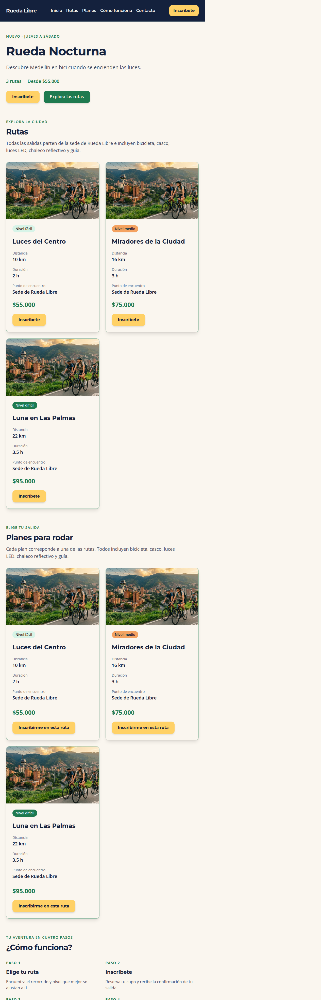
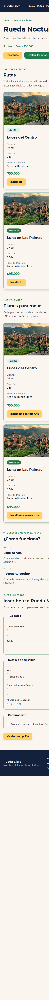
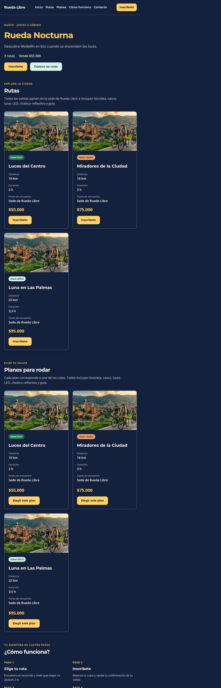

# Rueda Libre v2.0 y campaña Rueda Nocturna

Sitio de alquiler de bicicletas y recorridos guiados en Medellín, acompañado
por una landing de campaña mobile-first. El producto integra el sitio
principal construido con Bootstrap y la campaña construida con Tailwind CSS.

## Sitios publicados

Las rutas públicas respondieron HTTP 200 al verificarlas el 30 de octubre de
2026:

- [Rueda Libre — inicio](https://eligiusdev.github.io/rueda-libre/)
- [Tarifas y rutas](https://eligiusdev.github.io/rueda-libre/paginas/tarifas.html)
- [Reservas](https://eligiusdev.github.io/rueda-libre/paginas/reservas.html)
- [Rueda Nocturna](https://eligiusdev.github.io/rueda-libre/nocturna/)

> **Estado del lanzamiento:** los enlaces publicados existen, pero los cambios
> locales descritos en esta edición aún requieren `git push`. La publicación
> está pendiente de autenticación de GitHub; por ello, no se afirma que estas
> páginas ya incluyan la última corrección local de accesibilidad.

## Páginas y funcionalidades

- `index.html`: portada, promociones, catálogo de bicicletas, recorridos,
  beneficios, servicios y contacto.
- `paginas/tarifas.html`: tarifas de bicicletas y recorridos.
- `paginas/reservas.html`: formulario validado, opciones de bicicleta y
  recorrido, políticas y datos de contacto.
- `nocturna/index.html`: hero de campaña, tres rutas, sección de planes basada
  en esas rutas, cuatro pasos,
  inscripción y pie de página con enlaces al sitio.
- `nocturna/componentes.html`: kit de componentes de Rueda Nocturna.

El formulario de Nocturna valida los datos en el navegador, pero esta versión
no los envía ni los almacena. Se necesita configurar un backend o servicio
autorizado antes de recibir inscripciones reales.

## Tecnologías y marca

- HTML semántico y accesible.
- Bootstrap 5.3.8 en el sitio principal.
- Tailwind CSS 4.3.3 CLI en la landing, con `@theme`, utilidades responsive,
  modo oscuro por preferencia del sistema y tres clases de botones con
  `@apply`.
- Montserrat para títulos y Open Sans para texto, cargadas desde Google Fonts.
- Colores compartidos: Crema `#FAF6EF`, Azul Noche `#14213D`, Verde Ruta
  `#1E7A4F`, Verde Claro `#D7F4E8`, Naranja Pedal `#F4A261` y Amarillo Farol
  `#FFD166`.

Para regenerar el CSS minificado:

```sh
cd nocturna
./node_modules/.bin/tailwindcss -i ./src/input.css -o ./src/output.css --minify
```

`nocturna/src/output.css` está versionado y mide **28.303 bytes**. La
compilación reproducida desde `nocturna/` coincide con el archivo entregado.

## Responsive y accesibilidad

En Chromium local se revisaron las cuatro páginas principales a 360, 768 y
1280 px: ninguna presentó desbordamiento horizontal; las imágenes cargaron y
todas tienen texto alternativo. La landing también se probó a 640 y 1024 px:

| Ancho | Rutas | Planes | Pasos | Encabezado de Nocturna |
| ---: | ---: | ---: | ---: | --- |
| 360 px | 1 columna | 1 columna | 1 columna | Apilado; enlaces ocultos y CTA visible |
| 640 px | 2 columnas | 2 columnas | 2 columnas | Apilado; enlaces ocultos |
| 768 px | 2 columnas | 2 columnas | 2 columnas | En fila; navegación visible |
| 1024 px | 3 columnas | 3 columnas | 4 columnas | En fila |
| 1280 px | 3 columnas | 3 columnas | 4 columnas | En fila |

El formulario de campaña usa `fieldset`, `legend`, etiquetas asociadas y
validación nativa: nombre de al menos 3 caracteres, correo válido, celular de
10 dígitos que comienza en 3, acompañantes de 0 a 3, selecciones obligatorias
y aceptación de condiciones. Se completó también con teclado. La emulación
`prefers-color-scheme: dark` aplica Azul Noche a las superficies. Las
combinaciones de texto revisadas superan 4,5:1; no se usa Verde Ruta como texto
normal sobre Azul Noche.

Nu Html Checker 26.10.18 validó las copias locales de `nocturna/index.html` y
`paginas/reservas.html` sin errores ni avisos. En el sitio publicado, la landing
también pasó sin errores; la versión pública de Reservas aún mostraba un error
de `aria-labelledby` en el modal. Se añadió `role="dialog"` al modal local y la
copia corregida pasó la validación. El resultado público se actualizará cuando
se publiquen los cambios pendientes.

## Capturas

Capturas locales de la landing completa:

### Escritorio — 1280 px



### Celular — 360 px



### Modo oscuro — 1280 px



## MiniReto 8: Bootstrap vs. Tailwind

Mediciones anotadas en DevTools y la bitácora:

| Criterio | Bootstrap 5.3.8 | Tailwind CSS |
| --- | --- | --- |
| Curva de aprendizaje | Componentes y patrones listos; requiere aprender estructura y opciones. | Requiere aprender utilidades y ordenar clases; la composición aceleró el diseño de la landing. |
| Personalización | Variables y estilos propios sobre componentes del framework. | `@theme` permitió aplicar directamente colores, fuentes, breakpoints y modo oscuro. |
| Tamaño medido | CSS 33.048 B y JS 24.469 B transferidos con Brotli; sin comprimir, 232.111 B y 80.496 B. | CSS minificado actual de 28.303 B sin comprimir; Tailwind no requiere JS del framework en el navegador. |
| Casos de uso | Páginas que priorizan componentes convencionales listos y un arranque rápido. | Interfaces con diseño propio y CSS final limitado a las utilidades detectadas. |

Los tamaños transferidos de Bootstrap comprimido no son directamente
comparables con el CSS local de Tailwind sin comprimir. Para la próxima versión
integral de Rueda Libre se recomienda **Tailwind**, conservando los tokens y el
kit como sistema visual común: en esta experiencia permitió adaptar la marca
con precisión y produjo un CSS final menor que la respuesta CSS de Bootstrap
comprimida, aunque exige disciplina para mantener legibles las listas de
utilidades. Bootstrap sigue siendo una opción válida para pantallas basadas en
componentes estándar.

## Demo de tres minutos

1. **0:00–0:25 — Contexto:** explicar que la campaña busca convertir visitas
   móviles en participantes de recorridos nocturnos.
2. **0:25–1:05 — Sitio:** abrir Inicio, enseñar catálogo y promociones, y entrar
   a Rueda Nocturna desde la navegación/carrusel.
3. **1:05–1:40 — Landing:** recorrer las rutas y sus planes, los cuatro pasos;
   mostrar que el logo vuelve al sitio.
4. **1:40–2:15 — Inscripción:** seleccionar un plan para preelegir su ruta,
   demostrar validación vacía y completar el formulario con teclado. Aclarar
   que hoy solo valida localmente y aún no recibe datos.
5. **2:15–2:40 — Adaptación:** mostrar la vista a 360 px y activar la
   preferencia de color oscuro.
6. **2:40–3:00 — Decisiones:** explicar el diseño mobile-first y la
   recomendación de Tailwind basada en el tamaño medido y la personalización.

**Ensayo y retroalimentación:** pendientes de realizar con un compañero. No se
atribuye una retroalimentación que todavía no se ha recibido.

## MiniReto 11: planes de salida

La sección de planes reutiliza las tres rutas, duraciones, distancias, niveles
y precios aprobados, sin crear una oferta nueva. Sus cards combinan Grid para
distribuirse en una, dos y tres columnas; Flexbox mantiene las acciones
alineadas y las utilidades de padding, borde y separación resuelven el box
model. Cada CTA lleva al formulario y preselecciona la ruta correspondiente.

## Aprendizajes y pendientes de entrega

- Reutilizar componentes del kit evita variantes visuales divergentes.
- Grid resuelve las tarjetas y los pasos; Flexbox organiza navegación y pie.
- Las etiquetas, estados de foco y validaciones nativas mejoran el uso por
  teclado y tecnologías de asistencia.
- Bootstrap y Tailwind pueden convivir si comparten valores de marca y rutas
  claras entre carpetas.
- La validación del navegador no equivale a recibir una inscripción: falta
  conectar un destino seguro y aprobado.
- Falta autenticar GitHub para subir el commit de lanzamiento y verificar que
  Pages sirva la versión actualizada. La demo está preparada, pero falta
  ensayarla con una persona y registrar su feedback.

## Autoría

Equipo del proyecto Rueda Libre — Nodo Digital.
